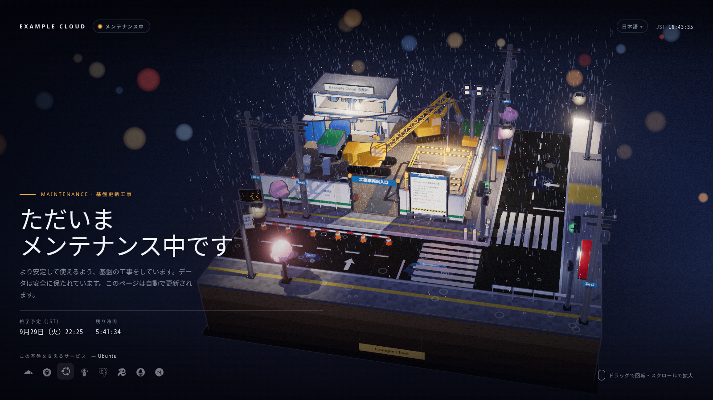

# maintenance-diorama

[English](README.md) · **日本語** · [简体中文](README.zh-CN.md)

Cloudflare Worker で配信する、映画のワンシーンのようなメンテナンスページです。
雨の夜、日本の街角にある工事現場をトゥーン調の three.js ジオラマで描き、
ブランド名、現在時刻、終了予定とカウントダウン、そして基盤を支えるサービスの
アイコンを重ねて表示します。




- **エッジから配信、切り替えは変数ひとつ。** Worker はルートに常駐し、
  `MAINTENANCE=on` のときだけ設定したすべてのホストがメンテナンス表示（HTTP 503
  と `Retry-After`）になります。それ以外はリクエストをそのままオリジンへ通します。
  Cloudflare のダッシュボードから数秒で切り替えられ、オリジンやゲートウェイ、
  トンネルが止まっていても表示されます。
- **設定ファイルひとつ。** ホスト名、ブランド、言語、終了予定、タイムゾーン、
  サービスアイコンはすべて `maintenance.config.json` に書きます。
- **多言語対応。** 日本語、英語、簡体字・繁体字中国語、韓国語、スペイン語、
  フランス語、ドイツ語を同梱。`Accept-Language` で自動選択し、ページ内の
  メニュー（`?lang=`）で切り替えられます。言語は設定で追加できます。
- **静かに動く。** 雨、波紋、水たまりの映り込み、セグメントを吊り下ろす
  クレーン、信号、ちらつく看板、そして四季（桜、夏の雨、紅葉、雪）。
  ドラッグで回転、スクロールで拡大。
- **壊れにくい。** 文章は本物の HTML なので、WebGL や JavaScript がなくても
  読めます。`prefers-reduced-motion` に従い、JSON クライアントや GET 以外の
  リクエストには JSON の 503 を返します。

## はじめかた

Node.js 22 以上と、対象ゾーンを持つ Cloudflare アカウントが必要です。

```bash
npm ci
cp maintenance.config.example.json maintenance.config.json   # 編集する
npm run build && npm run preview    # dist/preview.html をブラウザで開く
npx wrangler login
npm run off                         # Worker を設置（トラフィックは素通し）
npm run on                          # 設定したルートすべてでメンテナンス開始
npm run off                         # メンテナンス終了
```

## メンテナンスの開始と終了

切り替えは Worker 変数 `MAINTENANCE` です。`on` でページを表示し、それ以外
（未設定を含む）ではすべてのリクエストをそのまま通します。

- **ダッシュボード：** Workers & Pages → 対象の Worker → Settings → Variables and
  Secrets → `MAINTENANCE` を `on` または `off` に → Deploy。数秒で反映され、
  ターミナルは要りません。
- **CLI：** `npm run on` / `npm run off`。

生成される `wrangler.toml` は `keep_vars = true` なので、設定を編集したあとの
`npm run deploy` でもダッシュボードの状態はそのまま残ります。`npm run remove`
で Worker とルートを削除します。

Worker はルートに常駐するため、メンテナンスが off のときも対象ホストへの
リクエストはすべて Worker を通り、Workers のリクエスト枠（Free プランは 1 日
10 万件）を消費します。素通しの CPU 時間は 1 ミリ秒未満です。枠に近い場合は、
ダッシュボードでルートの失敗時動作を *fail open* にしておくと、上限を超えた
リクエストはオリジンへ直接届きます。

`maintenance.config.json` は Git の管理対象外です。別の場所に置く場合は
`MAINTENANCE_CONFIG` で指定します。

```bash
MAINTENANCE_CONFIG=../ops/maintenance.config.json npm run on
```

`wrangler.toml` は `npm run build` が設定から生成します。生成物ではなく設定を
編集してください。

## 設定項目

| キー | 内容 |
|---|---|
| `worker.name` | Worker のスクリプト名 |
| `routes` | `[{ pattern, zone }]`。切り替えの対象になる Worker ルート |
| `passHosts` | メンテナンス表示を通さないホスト（アクセス制御付きの管理画面など） |
| `until` | 終了予定（ISO 8601, UTC）。カウントダウンと `Retry-After` に使います |
| `timeZone` | `{ id, label }`。例：`{ "id": "Asia/Tokyo", "label": "JST" }` |
| `defaultLanguage` | 訪問者の言語が設定にないときの言語 |
| `sites` | `[{ hosts, brand }]`。ホストごとのブランド名（`*.example.com` 可） |
| `copy` | 言語ごとの文言：`label`、`title`、`status`、`eyebrow`、`headline`（`\n` で改行）、`body`、`etaLabel`（`{tz}`）、`soon`、`left`、`services`、`hint` |
| `notice` | ジオラマ内の告示板の文言。`{brand}` と `{end}` が置き換わります。`address` は電柱の住所表示 |
| `services` | `[{ icon, name }]`。`icon` は [Simple Icons](https://simpleicons.org) のスラッグ |

言語を追加するには、BCP 47 のタグ（`pt-BR`、`it` など）をキーにして `copy` に
項目を足します。日付は ja・zh・ko・en は専用の書式、それ以外は
`Intl.DateTimeFormat` で表示します。

ジオラマの告示板は日本の街角なので日本語のままにしています。`notice` を書き換えれば
自由に変えられます。

終了予定は Worker 変数 `MAINTENANCE_UNTIL` でも上書きできます。

## プレビュー

`npm run preview -- <ホスト> <言語>` で、ホストと言語を指定して描画します。
プレビューでも本番でも、`?season=spring|summer|autumn|winter` で季節を、
`?still=1` で自動回転の停止を指定できます。

## クレジット

- [three.js](https://threejs.org)（MIT）
- ブランドアイコンは [Simple Icons](https://simpleicons.org)（CC0）。ロゴは各社の
  商標です。実際に使っているサービスだけを表示してください。

## ライセンス

MIT
