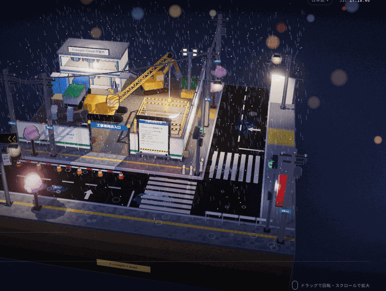
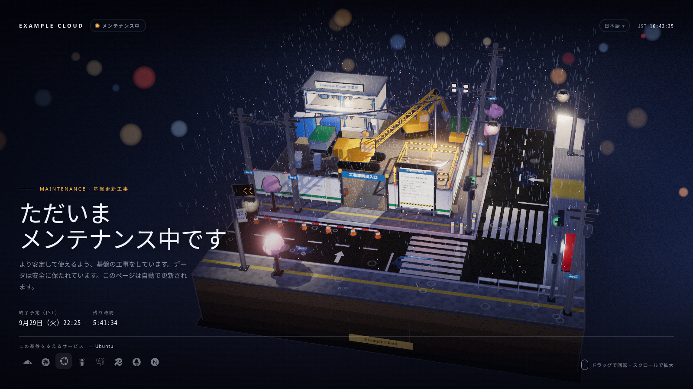

# maintenance-diorama

**English** · [日本語](README.ja.md) · [简体中文](README.zh-CN.md)

A cinematic maintenance page served from a Cloudflare Worker. The page is a
toon-shaded three.js diorama of a rainy-night Japanese street-corner
construction site, framed like a film still: your brand, a live clock, the
expected end with a countdown, and a strip of the services your platform runs.





- **Served from the edge, switched by one variable.** The Worker stays on your
  routes. With `MAINTENANCE=on` every configured hostname gets the page (HTTP
  503 with `Retry-After`); otherwise requests pass straight through to your
  origin. Flip it from the Cloudflare dashboard in seconds. The page keeps
  working while your origin, gateway or tunnel is down.
- **One config file.** Hostnames, brands, languages, the end time, the time
  zone and the service icons all live in `maintenance.config.json`.
- **Multilingual.** Japanese, English, Simplified and Traditional Chinese,
  Korean, Spanish, French and German out of the box, picked from
  `Accept-Language`, switchable in the page (`?lang=`), and extensible in the
  config.
- **Alive, but calm.** Rain, ripples and puddle reflections, a crane lowering a
  segment, traffic lights, flickering signs, and a four-season cycle (cherry
  blossom, summer rain, autumn leaves, snow). Drag to orbit, scroll to zoom.
- **Graceful.** The text is real HTML: it reads without WebGL or JavaScript,
  respects `prefers-reduced-motion`, and JSON clients and non-GET requests get
  a JSON 503.

## Quick start

Requires Node.js 22+ and a Cloudflare account with the zones you want to cover.

```bash
npm ci
cp maintenance.config.example.json maintenance.config.json   # then edit it
npm run build && npm run preview    # dist/preview.html, open it in a browser
npx wrangler login
npm run off                         # install the Worker, passing traffic through
npm run on                          # maintenance ON for every configured route
npm run off                         # maintenance OFF
```

## Switching maintenance on and off

The switch is the Worker variable `MAINTENANCE`: `on` shows the page, anything
else (including unset) passes every request through untouched.

- **Dashboard:** Workers & Pages → your Worker → Settings → Variables and
  Secrets → set `MAINTENANCE` to `on` or `off` → Deploy. It takes effect within
  seconds; no terminal needed.
- **CLI:** `npm run on` / `npm run off`.

The generated `wrangler.toml` sets `keep_vars = true`, so a plain
`npm run deploy` (for example after editing the config) keeps whatever state
the dashboard is in. `npm run remove` deletes the Worker and its routes.

Because the Worker stays on the routes, every request to those hostnames runs
it, including when maintenance is off, and counts against your Workers request
quota (100,000 a day on the Free plan). Pass-through costs well under a
millisecond of CPU. If you are near the quota, set the routes' failure mode to
*fail open* in the dashboard so that traffic over the limit goes straight to
the origin.

`maintenance.config.json` is ignored by Git. To keep it somewhere else, point
`MAINTENANCE_CONFIG` at it:

```bash
MAINTENANCE_CONFIG=../ops/maintenance.config.json npm run on
```

`npm run build` generates `wrangler.toml` from the config; edit the config, not
the generated file.

## Configuration

| Key | Meaning |
|---|---|
| `worker.name` | Worker script name |
| `routes` | `[{ pattern, zone }]` Worker routes: the hostnames the switch covers |
| `passHosts` | Hostnames that bypass the page, e.g. an admin console behind an access proxy |
| `until` | Expected end, ISO 8601 (UTC); drives the countdown and `Retry-After` |
| `timeZone` | `{ id, label }`, e.g. `{ "id": "Asia/Tokyo", "label": "JST" }` for the clock and dates |
| `defaultLanguage` | Language used when the visitor's language is not configured |
| `sites` | `[{ hosts, brand }]`: the brand shown for each host (`*.example.com` wildcards) |
| `copy` | Page text per language: `label`, `title`, `status`, `eyebrow`, `headline` (`\n` = line break), `body`, `etaLabel` (`{tz}`), `soon`, `left`, `services`, `hint` |
| `notice` | Text of the notice board inside the scene; `{brand}` and `{end}` are filled in; `address` is the plate on the utility poles |
| `services` | `[{ icon, name }]`, where `icon` is a [Simple Icons](https://simpleicons.org) slug |

To add a language, add an entry to `copy` keyed by its BCP 47 tag (`pt-BR`,
`it`, ...). Dates use built-in formats for ja, zh, ko and en and
`Intl.DateTimeFormat` for everything else.

The notice board in the scene stays Japanese by design: it is a Japanese street.
Change `notice` to write your own.

The expected end can also be moved without editing the config by setting the
Worker variable `MAINTENANCE_UNTIL`.

## Preview options

`npm run preview -- <host> <language>` renders the page for one host and
language. In the preview or on the live page, add `?season=spring|summer|autumn|winter`
to start in a season and `?still=1` to stop the slow auto-orbit.

## Project layout

```
scene/diorama.js     the three.js scene
scene/overlay.js     service strip, clock, countdown, film grain
src/page.html        the page template
src/render.ts        renders the page (shared by the Worker and the preview)
src/index.ts         the Worker
scripts/configure.mjs  config -> dist/config.json + wrangler.toml
scripts/preview.mjs    single-file preview
```

## Credits

- [three.js](https://threejs.org) (MIT)
- Brand icons from [Simple Icons](https://simpleicons.org) (CC0). The logos are
  trademarks of their owners; show only services you actually use.

## License

MIT
